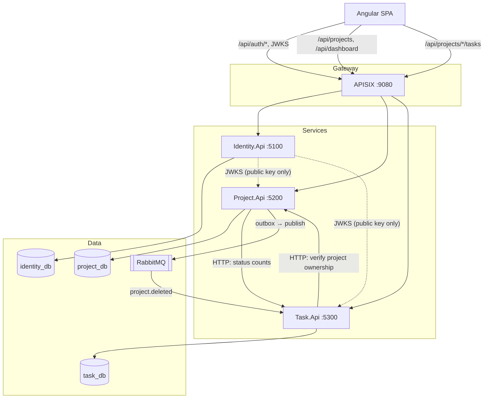

# TaskFlow — Microservices Edition

TaskFlow is a task and project management app, built here as a learning/portfolio project that
demonstrates a production-shaped **microservices** architecture end to end: an APISIX API gateway in
front of three independently deployable ASP.NET Core services, each owning its own PostgreSQL database
and talking to the others only over HTTP or async events — never a shared table or a shared ORM context.

Users can register, log in, create projects, add tasks to them, and track task status on a drag-and-drop
kanban board. Each user only sees and manages their own data. Functionally this is the same product as
the monolith this branch was converted from (see `main`) — what changed is the architecture, not the
feature set.

## Tech stack

| Layer | Technology |
|---|---|
| Frontend | Angular 22 (standalone components), Tailwind CSS, RxJS, Angular CDK (drag-drop) |
| API Gateway | Apache APISIX, standalone mode (static YAML, no etcd) |
| Services | ASP.NET Core 8 Web API, C# |
| Data access | **ADO.NET via Npgsql — no ORM.** All business logic lives in PostgreSQL functions; C# is a thin HTTP shell that calls them through one executor |
| Database | PostgreSQL 16, **one database per service** (`identity_db`, `project_db`, `task_db`) |
| Auth | RS256-signed JWTs, verified via a JWKS endpoint (no shared secret between services) |
| Messaging | RabbitMQ — transactional outbox + async domain events for cross-service consistency |
| Containerization | Docker + Docker Compose |

## Why microservices, and what changed from the monolith

The monolith on `main` is a single ASP.NET Core API with one EF Core `DbContext` over one database. This
branch splits that into three services along the same domain boundaries the monolith already had
(auth, projects, tasks), each independently deployable, each with its own schema it alone can write to.
That split forces three decisions a monolith doesn't:

- **Who owns the data.** Each service gets its own Postgres database and its own least-privilege DB role
  (`svc_identity`, `svc_project`, `svc_task`) with `EXECUTE` on that schema's functions and **zero table
  grants** — nothing, including the service's own code, can bypass the functions and touch a table
  directly.
- **How services trust each other's callers.** There's no shared secret to sign/verify JWTs with, because
  there's no shared anything — Identity.Api signs access tokens with its own RSA private key and publishes
  the public half at `/.well-known/jwks.json`; Project.Api and Task.Api fetch and cache that JWKS document
  and validate signatures against it.
- **How a change in one service's data stays consistent with another's.** Deleting a project has to delete
  its tasks, but Project.Api and Task.Api don't share a database or a transaction. That's handled with a
  **transactional outbox**: the delete and an `outbox_events` row are written in the same Postgres
  transaction, a background publisher drains that table onto RabbitMQ, and Task.Api consumes the event to
  cascade the delete on its side. If RabbitMQ is down for a minute, the event is still sitting in the
  outbox table waiting to be published — nothing is lost.

Synchronous, request-time needs (e.g. Task.Api checking a project exists and belongs to the caller before
creating a task under it) go over a plain HTTP call to Project.Api instead, with the result denormalized
onto the task (`user_id`) afterward so later reads don't need to call out again.

## Repository structure

```
demoproject/
├── src/
│   ├── ApiGateway/
│   │   └── apisix_conf/            config.yaml (standalone mode), apisix.yaml (routes)
│   ├── BuildingBlocks/              Shared libraries referenced by every service — never another
│   │   │                            service's own code
│   │   ├── Common.Data/             IPgFunctionExecutor — the one door to Postgres
│   │   ├── Common.Web/              ApiControllerBase, FnResult→HTTP mapping, error middleware
│   │   ├── Common.Security/         RS256 JWT issuing + JWKS publishing/consuming
│   │   └── Common.Messaging/        RabbitMQ publisher/consumer base classes
│   └── Services/
│       ├── Identity/
│       │   ├── Identity.Api/        Controllers/Services/Repositories/Program.cs/Dockerfile
│       │   ├── Identity.Tests/
│       │   └── database/            migrations/ (schema, role, grants) + procedures/ (one .sql per op)
│       ├── Project/                  same shape — owns projects + the outbox table
│       └── Task/                     same shape — owns tasks, consumes project.deleted events
├── frontend/                         Angular app (unchanged from the monolith branch — see below)
├── docker/postgres-init/              Creates the 3 databases and applies each service's migrations
├── docker-compose.yml                 postgres, rabbitmq, the 3 services, apisix, frontend
├── TaskFlow.sln
└── .env.example
```

Each service under `src/Services/*` follows the same internal shape:
`Controllers/ → Services/ → Repositories/ → IPgFunctionExecutor`, plus `Validators/`, `Models/`,
`Clients/` (typed `HttpClient`s for calling another service), `Messaging/` (outbox publisher or event
consumer, where applicable), `Extensions/`, and its own `database/migrations` + `database/procedures`.

## Architecture



Each service also exposes an internal-only surface the gateway doesn't route to publicly:
`POST /api/internal/tasks/status-counts` (called by Project.Api so the dashboard can show task counts
without Task.Api exposing a general-purpose cross-project query to the browser).

## Data access pattern: Postgres functions, not an ORM

There is no Entity Framework, no Dapper query building, and no raw SQL scattered through the services.
Every read and write is a single call through `IPgFunctionExecutor.CallAsync("schema.fn_name", actor,
payload, ct)`, which invokes a Postgres function with a fixed signature:

```sql
fn_name(p_actor_id uuid, p_actor_role text, p_payload jsonb) RETURNS jsonb
```

and a fixed response envelope: `{ ok, code, message, data }`. The function itself re-checks authorization
(it never trusts that the caller only asks for its own data), validates input, does the work, and returns
a domain `code` (`OK`, `VALIDATION`, `FORBIDDEN`, `NOT_FOUND`, `CONFLICT`, …). `Common.Web` maps that code
to an HTTP status once, in one place (`FnResultExtensions.ToHttp`), so a client never sees a stack trace,
a SQL error, or an internal exception message — only `{ "message": "..." }` with the right status code.

This means the database functions **are** the business logic. The C# controller for any endpoint is a
handful of lines: bind the request DTO, pull the actor off the validated JWT, call the function, map the
result to an `IActionResult`. Every function runs as `SECURITY DEFINER` with a pinned `search_path`, and
the service's own DB role has no table grants — only `EXECUTE` on its schema's functions — so even a bug
or a compromised service account can't read or write a table directly, only through the function it was
granted.

## Auth: RS256 + JWKS (no shared secret)

- Identity.Api holds an RSA private key (dev: a `.pem` generated on first run under
  `Identity.Api/keys/`, git-ignored; prod: mount it from a secret store/volume) and signs access tokens
  with it.
- `GET /.well-known/jwks.json` publishes **only the public key** in JWK format.
- Project.Api and Task.Api never see the private key. They fetch the JWKS document, cache it for 10
  minutes, and validate incoming tokens' signatures against the cached public key — resolved dynamically
  per `kid`, so the key can rotate without redeploying every service.
- Access tokens carry a multi-audience claim (`identity-service`, `project-service`, `task-service`) so
  one token works across all three without a gateway-level token exchange.

## API endpoints (as routed through the gateway)

| Method | Path | Service |
|---|---|---|
| POST | `/api/auth/register` | Identity.Api |
| POST | `/api/auth/login` | Identity.Api |
| POST | `/api/auth/refresh` | Identity.Api |
| POST | `/api/auth/logout` | Identity.Api |
| GET | `/.well-known/jwks.json` | Identity.Api |
| GET | `/api/projects` | Project.Api |
| GET | `/api/projects/{id}` | Project.Api |
| POST | `/api/projects` | Project.Api |
| PUT | `/api/projects/{id}` | Project.Api |
| DELETE | `/api/projects/{id}` | Project.Api (publishes `project.deleted` to the outbox) |
| GET | `/api/dashboard/summary` | Project.Api (calls Task.Api internally for status counts) |
| GET | `/api/projects/{projectId}/tasks` | Task.Api |
| GET | `/api/projects/{projectId}/tasks/{taskId}` | Task.Api |
| POST | `/api/projects/{projectId}/tasks` | Task.Api (calls Project.Api internally to verify ownership) |
| PUT | `/api/projects/{projectId}/tasks/{taskId}` | Task.Api |
| PATCH | `/api/projects/{projectId}/tasks/{taskId}/status` | Task.Api |
| DELETE | `/api/projects/{projectId}/tasks/{taskId}` | Task.Api |

All endpoints except `/api/auth/*` and the JWKS document require a `Bearer` access token. Every
project/task lookup enforces that the authenticated user owns the resource (403/404, never leaking
whether a resource exists for someone else).

Routing between `/api/projects/{id}` (Project.Api) and `/api/projects/{id}/tasks` (Task.Api) is
disambiguated in the gateway by route priority + a regex match on the `/tasks` suffix — see
`src/ApiGateway/apisix_conf/apisix.yaml`.

## Running it — Docker Compose (one command)

```bash
cp .env.example .env
```

Open `.env` and set real values (see the comments in `.env.example` — notably `POSTGRES_SUPERUSER_PASSWORD`
and `RABBITMQ_PASSWORD`; **`RABBITMQ_USER` must not be `guest`**, RabbitMQ's built-in guest account refuses
any non-loopback connection, which breaks every container-to-container login on the compose network).

```bash
docker compose up --build
```

This starts: a single Postgres container with three databases created and migrated automatically by
`docker/postgres-init/00-init-all.sh` (schema → procedures → least-privilege role grants, per service, in
order), RabbitMQ, the three .NET services, APISIX (standalone mode, routes loaded from
`src/ApiGateway/apisix_conf/apisix.yaml`), and the frontend.

Once everything is healthy:

- **App:** http://localhost:4200 (or `FRONTEND_PORT`)
- **Gateway:** http://localhost:9080/api/... (or `GATEWAY_PORT`) — the frontend's production build talks
  only to this address, never to a service directly.

Register an account, create a project, add a couple of tasks, drag one across the kanban columns, then
delete the project and watch its tasks disappear too (that's the outbox → RabbitMQ → Task.Api cascade,
not a cascading foreign key — there isn't one, the data lives in two different databases).

To stop: `docker compose down`.

## Running it locally without Docker (development)

Each service needs its own Postgres database, role, and connection string, plus the shared RabbitMQ
instance and the Identity service's JWKS endpoint reachable from the others.

**Backend** (requires .NET 8 SDK, PostgreSQL 16, RabbitMQ):

```bash
# For each service, in its own terminal:
cd src/Services/Identity/Identity.Api
export ConnectionStrings__Db="Host=localhost;Port=5432;Database=identity_db;Username=svc_identity;Password=<...>"
dotnet run

cd src/Services/Project/Project.Api
export ConnectionStrings__Db="Host=localhost;Port=5432;Database=project_db;Username=svc_project;Password=<...>"
export Jwt__JwksUrl="http://localhost:5100/.well-known/jwks.json"
export Services__TaskApiBaseUrl="http://localhost:5300"
dotnet run

cd src/Services/Task/Task.Api
export ConnectionStrings__Db="Host=localhost;Port=5432;Database=task_db;Username=svc_task;Password=<...>"
export Jwt__JwksUrl="http://localhost:5100/.well-known/jwks.json"
export Services__ProjectApiBaseUrl="http://localhost:5200"
dotnet run
```

Apply each service's `database/migrations/*.sql` then `database/procedures/*.sql` to its own database
before starting it (in that order — the same thing `docker/postgres-init/00-init-all.sh` automates for
the Docker Compose path).

**Frontend** (requires Node.js 22.22.3+):

```bash
cd frontend
npm install
npm start
```

`ng serve` uses `frontend/proxy.conf.js` as a local stand-in for the gateway, routing requests to whichever
of the three services on `localhost:5100/5200/5300` owns that path — the same routing rules as
`apisix.yaml`, just expressed as Vite's native proxy config (Angular's dev server no longer uses
webpack-dev-server, so a `router` callback isn't supported there — route specificity is handled by listing
the `/api/projects/*/tasks` pattern before the general `/api/projects` one; see the comments in that file).

## Running the tests

```bash
# All three services' unit tests (15 tests: validators, services, mapping)
dotnet test TaskFlow.sln

# Frontend unit tests
cd frontend && npx ng test

# Frontend lint
cd frontend && npx ng lint
```

Beyond unit tests, every endpoint listed above was exercised through the gateway path (register, login,
token refresh and revocation, every project/task CRUD operation, the cross-user 403 check, and the
project-delete → RabbitMQ → task cascade) and the full user journey was driven through a real browser
against the running Angular app.

## Secrets handling

No secrets are committed to this repository. `.env` is git-ignored; `.env.example` documents every
variable with safe placeholder values. Identity.Api's RSA signing key is generated on first run under
`Identity.Api/keys/` (git-ignored) for local/dev use; a real deployment should mount a pre-provisioned key
from a secret store instead of letting the service generate and persist its own.

## What's implemented vs. what a real production deployment would still need

**Implemented:**
- Three independently deployable services, each with its own database, own least-privilege DB role, and
  own Dockerfile
- RS256 JWT auth with a JWKS endpoint — no shared secret between services
- All data access through Postgres functions via a single executor — no ORM, no ad hoc SQL
- Transactional outbox + RabbitMQ for cross-service eventual consistency (project delete → task cascade)
- Synchronous service-to-service calls for request-time ownership checks, with denormalization to avoid
  repeated cross-service lookups
- An API gateway (APISIX) as the single entry point, with route-priority-based disambiguation between
  overlapping paths owned by different services
- Unit tests per service; full functional verification of every endpoint and the complete frontend user
  journey against the live stack

**Still needed for a real production deployment:**
- **APISIX in production mode** (etcd-backed) if routes need to change without a gateway restart/redeploy,
  plus TLS termination at the gateway.
- **Secret management** — a managed secret store for the Postgres/RabbitMQ credentials and the Identity
  signing key, not `.env` files or a key generated on container start.
- **Observability** — structured logging aggregation, distributed tracing across the three services and
  the gateway (a single user action now spans multiple processes), metrics, and alerting.
- **Outbox publisher resilience at scale** — the current polling publisher is correct but simple; a high
  write-volume deployment would want a dedicated relay (e.g. Debezium) or batching/backoff tuning.
- **Circuit breakers / retries with jitter** on the Project↔Task HTTP calls, beyond the basic timeout
  currently configured — a slow or down dependency shouldn't cascade into a slow gateway response.
- **A real deployment target** (Kubernetes, ECS, Container Apps) with per-service scaling, health-based
  routing, and a CD pipeline building/pushing/deploying each service's image independently.
- **Database migration strategy** for zero-downtime deploys of each service's schema independently.
- **Backups & disaster recovery** for each of the three Postgres databases.
- **Rate limiting at the gateway** on the auth endpoints in particular.
